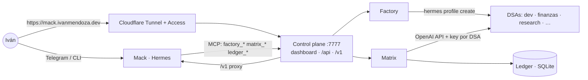

# Mack · mack.ivanmendoza.dev

Agente personal que corre 24/7 en el Mac mini, construido sobre [Hermes Agent](https://github.com/NousResearch/hermes-agent) (Nous Research).

| Pieza | Qué es | Dónde vive |
|---|---|---|
| **Mack** | El orquestador y tu único punto de contacto (Telegram, CLI, `/v1`) | Perfil Hermes `mack`, puerto 8642 |
| **Factory** | Crea DSAs: perfil Hermes aislado con SOUL, modelo, skill packs, API server y presupuesto | `src/factory.ts`, `templates/`, `packs/` |
| **DSA** | Domain Specific Agent: un experto persistente por dominio | Perfiles Hermes, puertos 8650-8699 |
| **Matrix** | Enruta tareas a DSAs, despacha en paralelo, aplica presupuestos | `src/matrix.ts` |
| **Ledger** | Tokens y USD por agente, presupuestos mensuales y suscripciones | `src/ledger.ts` |
| **Control plane** | API HTTP, dashboard y proxy OpenAI-compatible | `src/server.ts`, puerto 7777, publicado con Cloudflare Tunnel |



## La inteligencia de desarrollo: skills de Matt Pocock

El DSA `dev` (`templates/dev.yaml`) no improvisa su forma de trabajar: su SOUL lo obliga a elegir y seguir una skill de [mattpocock/skills](https://github.com/mattpocock/skills) en cada tarea (`to-spec` → `to-tickets` → `implement` + `tdd` → `code-review` → `pr`, `diagnosing-bugs`, `codebase-design`, etc.).

Las skills se distribuyen como **skill packs** (`packs/*.yaml`). Cada pack es un subconjunto curado de un repo, **fijado a un commit**. El Factory lo copia a `~/.mack/packs/<pack>/` y lo conecta al perfil con `skills.external_dirs`.

- `matt-pocock-engineering`: el ciclo de ingeniería completo (19 skills).
- `matt-pocock-thinking`: grilling, handoff, teach y `writing-for-agents`. Lo usan Mack y casi todos los DSAs. Mack lo usa también para redactar el SOUL de cada DSA nuevo.

Para actualizar, cambia `commit:` en el pack. Se vuelve a copiar solo si el commit cambió.

## Instalación (Mac mini)

```bash
./scripts/bootstrap.sh
```

El script se puede volver a correr sin problema. Hace esto:
1. Instala Hermes Agent con el script oficial, si falta (pide confirmación).
2. `npm ci` y genera `MACK_TOKEN` en `~/.mack/.env` (chmod 600).
3. `mackctl init`: crea el perfil `mack` con su SOUL, el pack de pensamiento, las skills `mack-*` y el MCP server `mack`. Después corre `hermes -p mack setup` para que configures tu proveedor de modelo y Telegram.
4. Instala el gateway de Mack y el control plane como servicios de launchd.
5. Crea el Cloudflare Tunnel `mack` y el DNS de `mack.ivanmendoza.dev`.

Después del bootstrap:
- **Protege el dominio con Cloudflare Access** (Zero Trust → Applications). Para clientes de `/v1` (apps móviles, Open WebUI) agrega una política de service token.
- Crea tus primeros DSAs: `npm run mackctl -- create dev`, `… create finanzas`, `… create research`.
- Registra tus suscripciones desde Telegram ("Mack, registra mi Claude Max de $200 que renueva el 1 de diciembre") o con `PUT /api/ledger/subscriptions`.
- Llena `pricing` en `mack.config.yaml` para tener costos en USD de lo que se mide por tokens.

## Uso

**Hablarle:** por Telegram, con `hermes -p mack`, o con cualquier cliente OpenAI en `https://mack.ivanmendoza.dev/v1` (Bearer `MACK_TOKEN`, model `mack`).

**Crear un DSA platicando:** "Mack, necesito un agente para mis viajes". Mack sigue la skill `mack-factory`: te hace algunas preguntas, redacta el spec, te lo muestra y lo crea cuando confirmas.

**CLI:**
```bash
npm run mackctl -- agents | health | ledger
npm run mackctl -- create templates/dev.yaml --name dev-ivan
npm run mackctl -- route "revisa el bug del login en TypeScript"
npm run mackctl -- dispatch "resume mis gastos de octubre" --agent finanzas
npm run mackctl -- init --dry-run      # simula sin tocar Hermes
```

**API** (Bearer `MACK_TOKEN`):

| Método | Ruta | |
|---|---|---|
| GET/POST | `/api/agents` | listar / crear DSA (JSON o YAML) |
| DELETE | `/api/agents/:name` | eliminar DSA |
| GET | `/api/agents/health` | estado de cada API server |
| GET / POST | `/api/templates`, `/api/templates/:t/instantiate` | plantillas |
| POST | `/api/matrix/route` · `/dispatch` · `/fanout` | orquestación |
| GET | `/api/ledger/summary` | gasto del mes |
| PUT/DELETE | `/api/ledger/subscriptions[/:id]` | suscripciones |
| PUT | `/api/ledger/budgets/:agent` | presupuesto (`402` cuando se excede) |
| * | `/v1/*` | proxy OpenAI-compatible hacia Mack |

## Diseño y seguridad

- **Aislamiento:** cada DSA es un perfil Hermes con su propia memoria, sesiones, skills y API key. Escucha solo en `127.0.0.1`. Nada más el control plane sale a internet, por el túnel.
- **Secretos:** los DSAs heredan solo las llaves de proveedor listadas en `hermes.inheritEnv`. Los tokens de Telegram y demás plataformas se quedan con Mack. La API key de cada DSA nunca sale del Mac mini.
- **Enrutamiento:** Matrix enruta de forma determinista por las palabras clave de `domains`. Si ningún DSA reclama la tarea, Mack la resuelve. Un DSA puede devolverla con `FUERA_DE_DOMINIO`.
- **Matrix vs. `delegate_task`:** Matrix es para expertos persistentes. `delegate_task` de Hermes es para subtareas efímeras.

## Límites actuales

- El Ledger mide lo que pasa por Matrix y por `/v1`. Las conversaciones directas con Mack por Telegram o CLI quedan en el `state.db` de Hermes y en `hermes insights`, pero todavía no se importan al Ledger. El siguiente paso es sincronizarlas desde `GET /api/analytics/usage` del dashboard de Hermes.
- Las suscripciones de tarifa fija se suman como costo mensual. El Ledger no sabe cuánto de su cuota llevas consumido.

## Desarrollo

```bash
npm test          # node:test, 20 tests
npm run typecheck
```

Requiere Node ≥ 24 (TypeScript nativo y `node:sqlite`).
