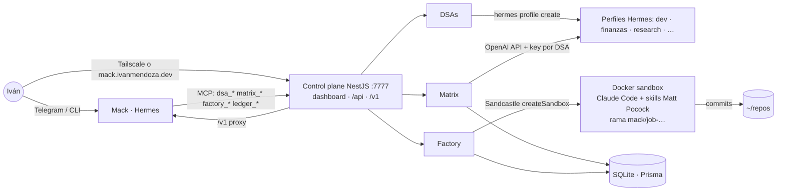

# Mack · mack.ivanmendoza.dev

Agente personal que corre 24/7 en el Mac mini. Está hecho sobre [Hermes Agent](https://github.com/NousResearch/hermes-agent) (Nous Research), [Sandcastle](https://github.com/mattpocock/sandcastle) y las [skills de Matt Pocock](https://github.com/mattpocock/skills).

| Pieza | Qué es | Código |
|---|---|---|
| **Mack** | Orquestador y tu único punto de contacto (Telegram, CLI, `/v1`) | Perfil Hermes `mack` (`hermes/mack.yaml`), puerto 8642 |
| **DSAs** | Domain Specific Agents: expertos persistentes por dominio, cada uno un perfil Hermes aislado | `src/dsa/`, `templates/`, puertos 8650-8699 |
| **Matrix** | Enruta tareas a DSAs, las despacha en paralelo y aplica presupuestos | `src/matrix/` |
| **Factory** | Agentes de código Claude Code AFK en sandboxes Docker vía Sandcastle; un trabajo = una rama | `src/factory/`, `factory/` |
| **Ledger** | Tokens y USD por agente, presupuestos mensuales y suscripciones | `src/ledger/` |
| **Control plane** | API NestJS + Prisma (SQLite), dashboard y proxy OpenAI-compatible | `src/`, puerto 7777 |



## Inteligencia de desarrollo: Matt Pocock

Las skills de [mattpocock/skills](https://github.com/mattpocock/skills) se distribuyen como **skill packs** (`packs/*.yaml`). Cada pack es un subconjunto curado del repo, **fijado a un commit** y copiado a `~/.mack/packs/<pack>/`.

- `matt-pocock-engineering`: 19 skills, entre ellas `tdd`, `implement`, `to-spec`, `to-tickets`, `code-review`, `diagnosing-bugs` y `codebase-design`.
- `matt-pocock-thinking`: `grilling`, `handoff`, `teach` y `writing-for-agents`. Mack usa este último para redactar el SOUL de cada DSA nuevo.

Las skills se usan en dos lugares:
1. **DSA `dev`** (perfil Hermes con ambos packs). Es el que **piensa**: aterriza la idea (`to-spec`), la parte en tickets (`to-tickets`), revisa el diseño y diagnostica.
2. **Factory**. Es el que **ejecuta**: el pack de ingeniería se monta en solo lectura en `~/.claude/skills` dentro de cada sandbox. Los prompts de `factory/prompts/` obligan a usar `tdd` al implementar y `code-review` en el pase de revisión.

## Factory (Sandcastle)

Cada trabajo crea, con `createSandbox`, un worktree y una rama `mack/<job>` en el repo, y levanta un contenedor `sandcastle:mack` (`factory/Dockerfile`). Ahí corre Claude Code en un loop AFK hasta emitir `<promise>COMPLETE</promise>` o agotar `maxIterations`.

| Flujo | Equivalente en Sandcastle | Qué hace |
|---|---|---|
| `implement` | `simple-loop` | Implementa el ticket con TDD y hace commits pequeños |
| `implement-review` (default) | `sequential-reviewer` | Igual que `implement`, más un segundo pase con `code-review` en el mismo sandbox que corrige lo que encuentre |

Para hacer varios tickets en paralelo (como `parallel-planner`), Mack o `dev` los planean y se encola un trabajo por ticket. La concurrencia se limita con `factory.maxConcurrent`.

Garantías:
- Solo acepta raíces de repos git dentro de `factory.repoRoots`.
- Nunca hace push ni toca la rama que tienes activa. El merge lo decides tú.
- Agrega `.sandcastle/` al `.git/info/exclude` local; no modifica archivos versionados.
- La cola vive en SQLite. Si el control plane se reinicia, los trabajos `running` se marcan `failed` y los `queued` se retoman.

Credenciales: `CLAUDE_CODE_OAUTH_TOKEN` (corre `claude setup-token` con tu suscripción Max) o `ANTHROPIC_API_KEY`, en `~/.mack/.env`.

## Instalación (Mac mini)

```bash
./scripts/bootstrap.sh
```

El script se puede volver a correr sin problema. Hace esto:
1. Instala Hermes Agent si falta.
2. Compila el proyecto (`npm ci && npm run build`).
3. Genera `MACK_TOKEN` y te pide el token de Claude Code.
4. Aplica las migraciones (`prisma migrate deploy`) y construye la imagen del sandbox.
5. Levanta el control plane con launchd.
6. Crea el perfil `mack` y corre `hermes -p mack setup` (modelo y Telegram).
7. Publica el acceso remoto: **Tailscale** (`tailscale serve`, privado, recomendado) o **Cloudflare Tunnel** para `mack.ivanmendoza.dev`. Si usas Cloudflare, protege el dominio con Cloudflare Access.

## Uso

**Hablarle:** por Telegram, con `hermes -p mack`, o con cualquier cliente OpenAI en `<url>/v1` (Bearer `MACK_TOKEN`, model `mack`).

**Platicando con Mack:**
- "Crea un agente para mis viajes" → skill `mack-dsa`.
- "Agrega login con passkeys a ~/repos/app" → `dev` redacta el spec y los tickets, y luego la skill `mack-factory` encola un trabajo por ticket.
- "¿Cuánto llevo gastado este mes?" → skill `mack-ledger`.

**CLI** (cliente ligero de la API; lee `~/.mack/.env`):
```bash
npm run mackctl -- agents | health | ledger | jobs
npm run mackctl -- create dev
npm run mackctl -- dispatch "resume mis gastos de octubre" --agent finanzas
npm run mackctl -- build ~/repos/app "Agrega GET /ping que regrese pong, con tests" --workflow implement
```

**API** (Bearer `MACK_TOKEN`):

| Método | Ruta | |
|---|---|---|
| GET/POST | `/api/agents` | listar / crear DSA (JSON o `application/yaml`) |
| DELETE | `/api/agents/:name` | eliminar DSA |
| POST | `/api/agents/:name/start` · `/stop` | gateway del DSA |
| GET | `/api/agents/health` | estado de cada API server |
| POST | `/api/orchestrator/init` | provisiona a Mack |
| GET / POST | `/api/templates`, `/api/templates/:t/instantiate` | plantillas de DSA |
| POST | `/api/matrix/route` · `/dispatch` · `/fanout` | orquestación |
| GET/POST | `/api/factory/jobs`, `/api/factory/jobs/:id` | trabajos del Factory |
| GET | `/api/ledger/summary` | gasto del mes |
| PUT/DELETE | `/api/ledger/subscriptions[/:id]` | suscripciones |
| PUT | `/api/ledger/budgets/:agent` | presupuesto (`402` cuando se excede) |
| * | `/v1/*` | proxy OpenAI-compatible hacia Mack |

## Diseño y seguridad

- **Aislamiento:** cada DSA es un perfil Hermes con su propia memoria, sesiones, skills y API key, y escucha solo en `127.0.0.1`. Cada trabajo del Factory corre en su propio contenedor y en su propio worktree.
- **Secretos:** los DSAs heredan solo las llaves de proveedor de `hermes.inheritEnv`. Los tokens de mensajería se quedan con Mack. La base guarda los specs sin el `env` de los servidores MCP.
- **Una sola fuente de verdad:** el estado vive en el control plane (SQLite vía Prisma). `mackctl` y el MCP de Mack son clientes HTTP.

## Límites actuales

- El Ledger mide lo que pasa por Matrix y por `/v1`. No incluye:
  - Las conversaciones directas con Mack por Telegram o CLI (se pueden sincronizar desde `GET /api/analytics/usage` del dashboard de Hermes).
  - El consumo del Factory: Sandcastle reporta el uso por iteración como una foto de la última llamada, no como un acumulado. Con `CLAUDE_CODE_OAUTH_TOKEN` ese gasto entra en tu suscripción Max, que sí aparece en el Ledger.
- Sandcastle falla con repos dentro de `/var/folders` (temporales de macOS, por el symlink a `/private`). Los repos en `~/repos` funcionan bien.

## Desarrollo

```bash
npm run build       # prisma generate + nest build (SWC)
npm test            # Vitest + @nestjs/testing, SQLite temporal por test
npm run typecheck
npm run dev         # nest start --watch
```

Stack: Node ≥ 24, NestJS 12, Prisma 7 (SQLite + better-sqlite3), Zod (Standard Schema), Sandcastle 0.14, Vitest. TypeScript se queda en 6.x porque el CLI de Nest todavía no soporta TS 7.
